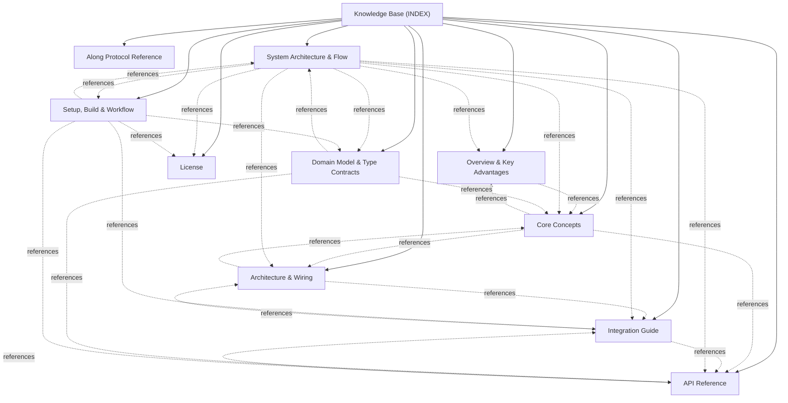

# @actdim/msgmesh-store - Knowledge Base Topic Index

Central entry point and cross-linked topic catalog for project documentation:

## Knowledge Graph & Topic Map

---

## Articles

- **[Overview & Key Advantages](./topic--01-overview-and-advantages.md)** (topic) `01-overview-and-advantages`, `overview`, `msgmesh`, `livestruct`, `cdc`
- **[Core Concepts](./topic--02-core-concepts.md)** (topic) `02-core-concepts`, `bridge`, `cdc`, `ledger`, `queue`, `worker`
- **[Architecture & Wiring](./topic--03-architecture-and-wiring.md)** (topic) `03-architecture-and-wiring`, `data-flow`, `echo-suppression`, `worker`, `mermaid`
- **[Integration Guide](./topic--04-integration-guide.md)** (topic) `04-integration-guide`, `install`, `livestruct`, `msgmesh`, `worker`, `batching`
- **[API Reference](./topic--05-api-reference.md)** (topic) `05-api-reference`, `api`, `contracts`, `exports`
- **[Along Protocol Reference](./topic--along-protocol.md)** (reference) `protocol`, `agents-md`, `checklist`, `routing`, `concurrency`, `along-team`, `conventions`
- **[System Architecture & Flow](./topic--architecture.md)** (architecture) `architecture`, `bridge`, `cdc`, `worker`, `echo-suppression`
- **[Domain Model & Type Contracts](./topic--domain-model.md)** (domain-model) `domain-model`, `types`, `cdc`, `commands`, `worker-protocol`
- **[License](./topic--license.md)** (license) `license`, `mit`
- **[Setup, Build & Workflow](./topic--setup-and-workflow.md)** (setup-workflow) `setup`, `workflow`, `build`, `tests`, `monorepo`

---

## Related Context

- [AGENTS.md](../AGENTS.md): Active protocol conventions and rules.
- [Decisions (ADRs)](./decisions/INDEX.md): Architectural Decision Records.
- [Domain Model & Entity Ecosystem](./topic--domain-model.md): Specifications for active issues and project history.
