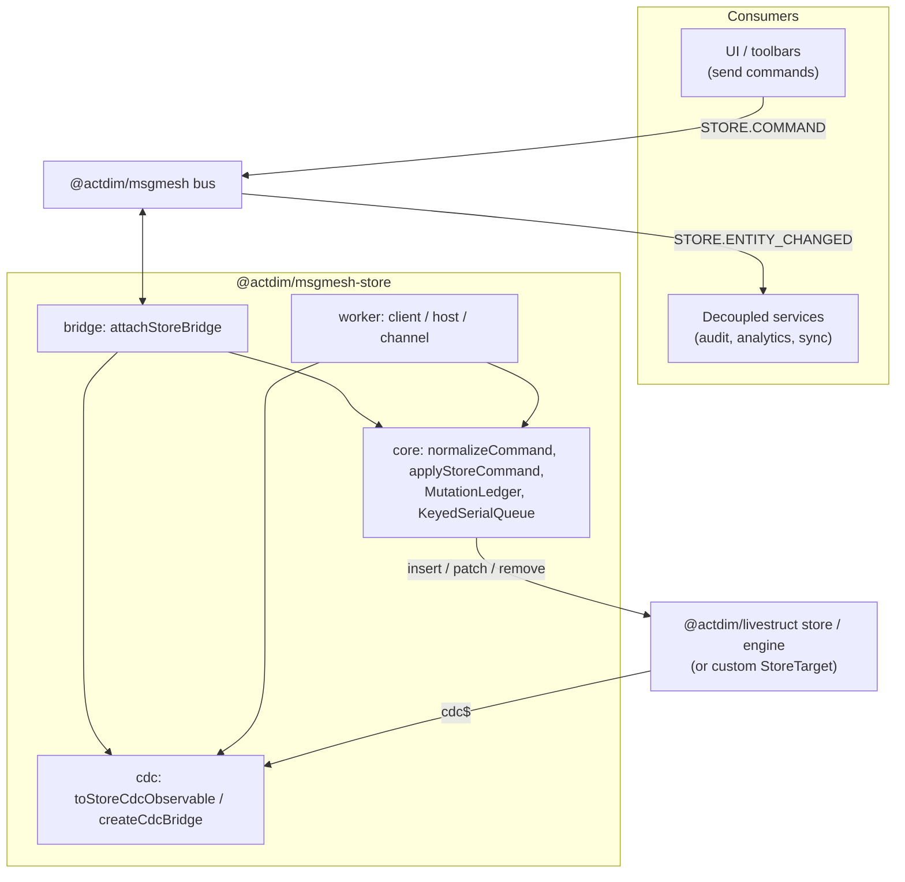
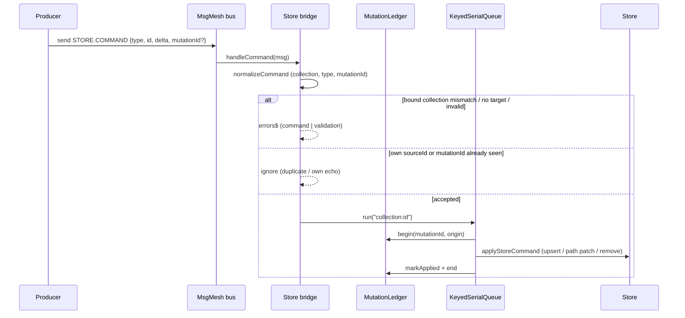
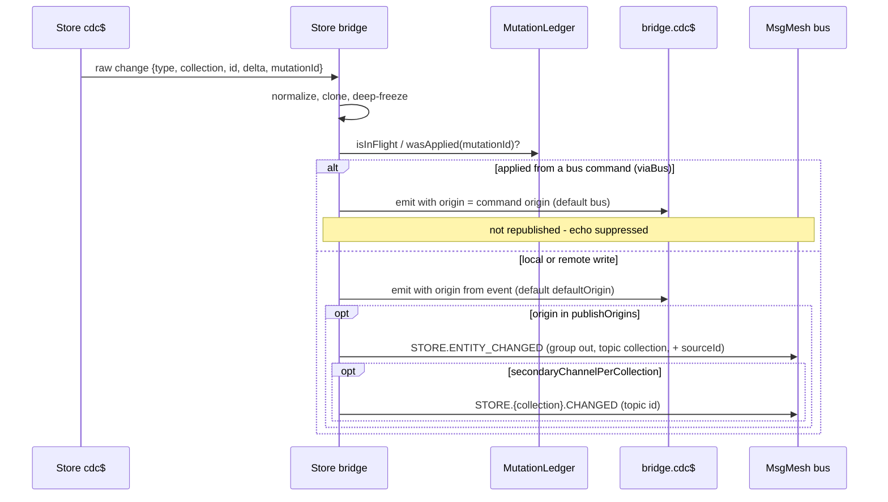
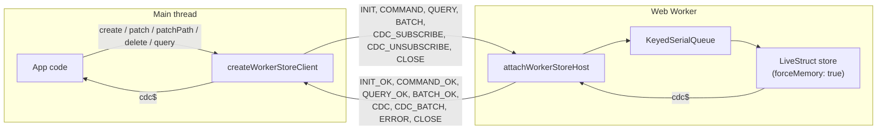
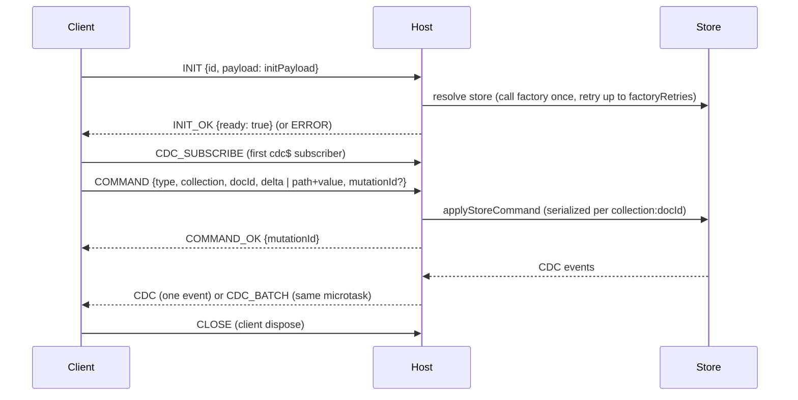
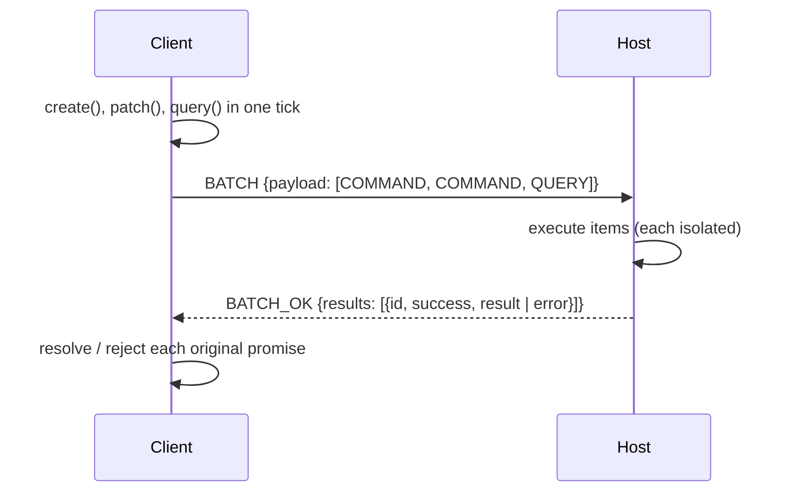

# Architecture & Wiring

[<- Back to 02. Core Concepts](./topic--02-core-concepts.md) | [Next: 04. Integration Guide ->](./topic--04-integration-guide.md)

---

## 1. Layers

- `core` has no knowledge of the bus or of workers. It normalizes commands, resolves store targets and applies mutations.
- `cdc` turns store streams into `StoreCdcEvent` and moves them to and from the bus.
- `bridge` composes `core` and `cdc` into a bidirectional bus attachment with echo suppression.
- `worker` composes `core` and `cdc` behind a `postMessage` protocol.

## 2. Command Path (bus -> store)

Key properties:
- Commands for the same `collection:id` are applied in arrival order; other documents proceed in parallel.
- A command with a `mutationId` that is in flight or already applied is dropped, which makes redelivery idempotent.
- `durable: true` additionally awaits `flush()` on the target.

## 3. Change Path (store -> bus)

### Why the loop cannot form

1. A bus command is recorded in the ledger before the store write.
2. The store emits a CDC event with the same `mutationId`.
3. The bridge sees the id in the ledger and does not publish to the bus.
4. If another bridge forwards a published event back as a command with the original `sourceId`, the originating bridge ignores it.

Because the ledger is count-bounded (not time-bounded), suppression does not depend on timing; only ids older than the last `ledgerCapacity` applied mutations are forgotten.

## 4. Bus Topology

| Channel | Group | Topic | Direction | Producer |
|---|---|---|---|---|
| `<prefix>.COMMAND` | `in` or `out` | any (often the collection, or a command verb) | -> store | application |
| `<prefix>.<collection>.COMMAND` | `in` or `out` | any | -> store | application (bound bridges only) |
| `<prefix>.ENTITY_CHANGED` | `out` | collection | <- store | `attachStoreBridge`, `createCdcBridge`, `publishCdcToBus` |
| `<prefix>.<collection>.CHANGED` | `out` | entity id | <- store | same, with `secondaryChannelPerCollection` |

The default prefix is `STORE`. Several bridges with different prefixes can share one bus, for example one per bounded context.

## 5. Worker Topology

### Handshake and requests

Lifecycle rules enforced by the client:
- Every request has a timeout (`requestTimeoutMs`, default 10000; `initTimeoutMs`, default 5000).
- A `CLOSE` message or port `close` event marks the client `dead` and rejects all pending requests with `WorkerDeadError`.
- A port `error` event is fatal under `errorPolicy: 'fatal'` (default) and only reported on `errors$` under `'log'`.
- Requests are checked for cloneability before sending, so a non-cloneable payload rejects immediately instead of breaking the port.

### Batching

With `batch: 'microtask'`, requests issued in the same tick are queued and flushed once:

A single queued request is sent unwrapped. `INIT` is never batched.

## 6. Combining Bridge and Worker

The two halves are independent. A common layout keeps the store in a worker and puts a bus on each side:

- Inside the worker, `attachStoreBridge(workerBus, store)` lets worker-side services exchange commands and CDC on a local bus.
- On the main thread, `createWorkerStoreClient(worker)` provides typed calls and `client.cdc$`; that stream can be forwarded to the main-thread bus with `publishCdcToBus(mainBus, client.cdc$)`.

See [04. Integration Guide](./topic--04-integration-guide.md) for runnable setups.

---

[<- Back to 02. Core Concepts](./topic--02-core-concepts.md) | [Next: 04. Integration Guide ->](./topic--04-integration-guide.md)
