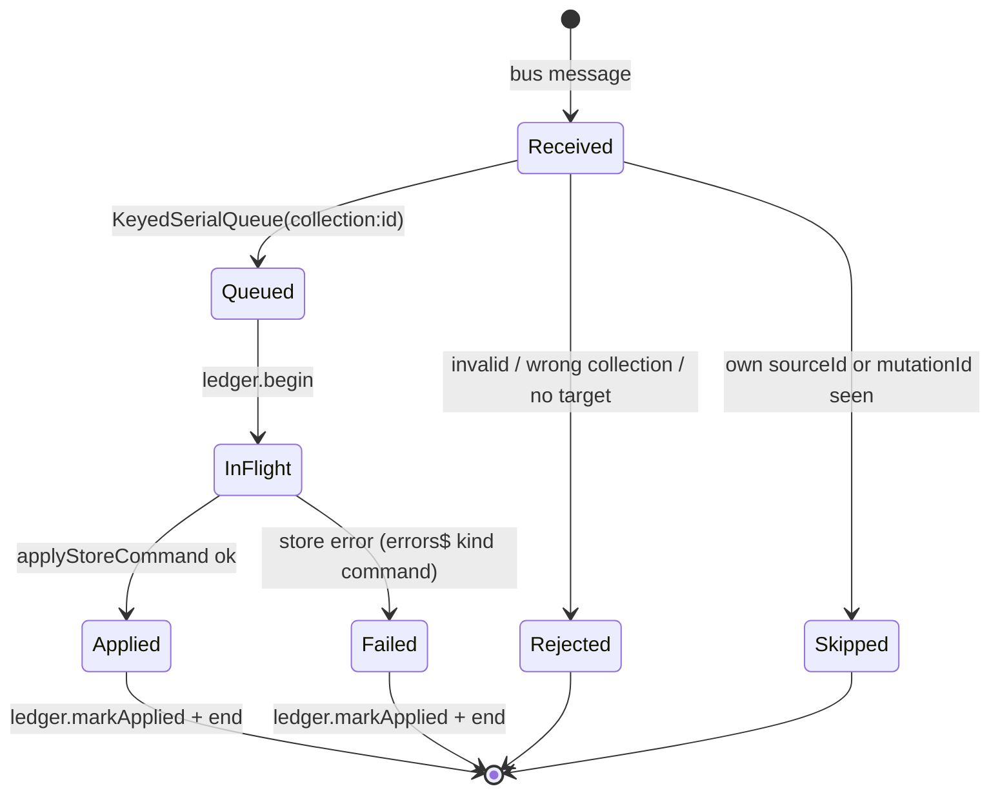
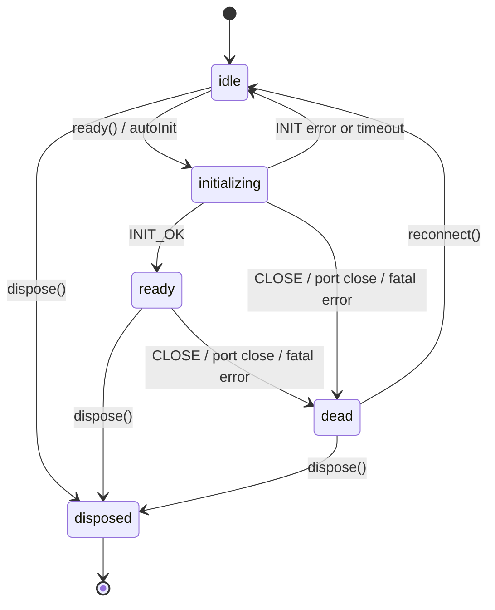

# @actdim/msgmesh-store Domain Model & Type Contracts

## 1. Domain Types Overview

The domain of `@actdim/msgmesh-store` has four groups of entities: **change events** flowing out of the store, **commands** flowing into it, **targets** that adapt concrete stores, and the **worker wire protocol**. Bookkeeping entities (`MutationLedger`, `KeyedSerialQueue`) tie them together. Full signatures are in the [API Reference](./topic--05-api-reference.md).

## 2. Change Events

### 2.1. `StoreCdcEvent<T>`
```typescript
interface StoreCdcEvent<T = Record<string, unknown>> {
    readonly type: StoreCdcType; // 'insert' | 'update' | 'delete'
    readonly collection: string;
    readonly id: string;
    readonly delta: Partial<T>;
    readonly origin: StoreCdcOrigin; // 'local' | 'remote' | 'bus'
    readonly timestamp: number;
    readonly mutationId?: string;
    readonly sourceId?: string;
}
```

- Identity: `collection` + `id` identify the document; `mutationId` identifies the write.
- `origin` drives publishing (`publishOrigins`) and filtering (`originFilter`).
- `sourceId` is the publishing bridge's random id; a bridge ignores commands that carry its own `sourceId`.
- Events are deep-frozen unless `freezeEvents: false`.

### 2.2. Filters
`CdcSubscriptionOptions` = `{ channelPrefix?, collection?, id?, originFilter?, typeFilter? }`, used by `subscribeCdc` and `filterCdc`.

## 3. Commands

### 3.1. `StoreCommandPayload<T>` (wire form on the bus)
```typescript
interface StoreCommandPayload<T = Record<string, unknown>> {
    readonly type?: StoreCommandType; // 'CREATE' | 'PATCH' | 'DELETE' | 'PATCH_PATH'
    readonly collection?: string;
    readonly id: string;
    readonly delta?: Partial<T> | Record<string, unknown>;
    readonly path?: string;
    readonly value?: unknown;
    readonly origin?: StoreCdcOrigin;
    readonly correlationId?: string;
    readonly mutationId?: string;
    readonly durable?: boolean;
    readonly sourceId?: string;
    // deprecated: action (use type), data (use delta)
}
```

### 3.2. `NormalizedStoreCommand` (internal form)
Produced by `normalizeCommand`: `type`, `collection` and `mutationId` are always set (a random UUID is generated when absent), `origin` defaults to `'bus'`, `rawPayload` keeps the original payload.

### 3.3. Command lifecycle


## 4. Targets

| Type | Shape | Typical source |
|---|---|---|
| `LiveStoreTarget` | `{ engine: LiveEngineTarget, collection?(name), flush? }` | `createLiveStruct(...)` |
| `LiveEngineTarget` | `{ getDoc, insertDoc, patchDoc, deleteDoc, flush? }` | `createLiveEngine(...)` |
| `LiveCollectionTarget` | `{ name, get, create, delete, flush? }` | `store.collection('users')` |
| `CustomStoreTarget` | `{ get, insert?, patch?, remove?, flush? }` or `{ collection(name), flush? }` | tests, adapters |
| `StoreTarget` | union of the above | `attachStoreBridge` input |
| `MutationTarget` | `{ boundCollection?, get, insert, patch, remove, flush? }` | output of `resolveMutationTarget` |

## 5. Bookkeeping

- **`MutationLedger`** - `inFlight: Map<mutationId, origin>`, `applied: Map<mutationId, timestamp>` bounded by `capacity` (default 4096).
- **`KeyedSerialQueue`** - one promise tail per key; same key FIFO, different keys concurrent.
- **`BridgeErrorEvent`** - `command` | `bus_send` | `validation`.

## 6. Worker Protocol

| Direction | Messages |
|---|---|
| Client -> host | `INIT`, `COMMAND`, `QUERY`, `BATCH`, `CDC_SUBSCRIBE`, `CDC_UNSUBSCRIBE`, `CLOSE` |
| Host -> client | `INIT_OK`, `COMMAND_OK`, `QUERY_OK`, `BATCH_OK`, `CDC`, `CDC_BATCH`, `ERROR`, `CLOSE` |

Requests carry an `id` that the response echoes; `CDC`, `CDC_BATCH` and `CLOSE` are unsolicited. Commands identify documents with `docId` (not `id`, which is the request id).

### Client state machine


## 7. Cross-Links

- [Knowledge Base Index](./INDEX.md)
- [System Architecture](./topic--architecture.md)
- [Core Concepts](./topic--02-core-concepts.md)
- [API Reference](./topic--05-api-reference.md)
